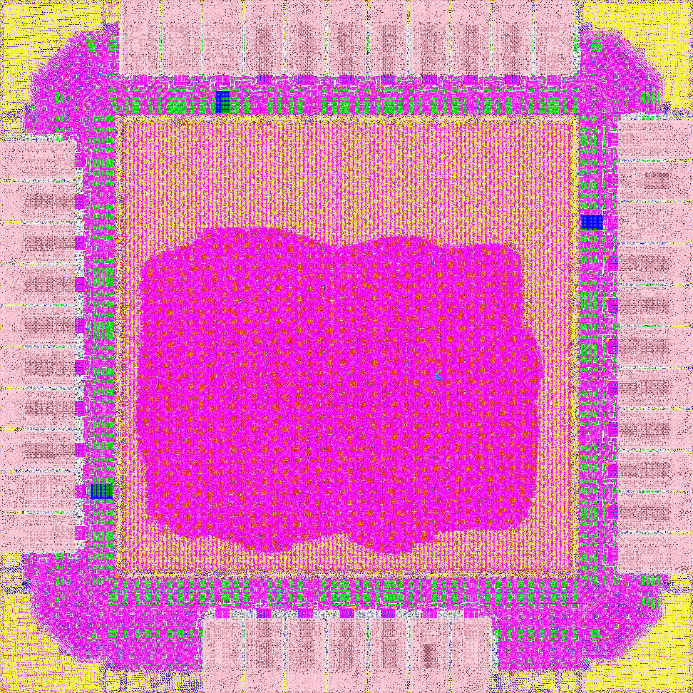

# IC Design Virtual Machine Environment and RTL2GDS

A preconfigured Red Hat Enterprise Linux 8.10 VMware environment for digital, analog, and mixed-signal IC design. The repository provides the image download location, import instructions, environment inventory tooling, troubleshooting notes, and a record of the RTL2GDS flow implemented in the VM.

## Reduced-Function Scripts and Usage Notice

The repository includes [rtl2gds_small](rtl2gds_small/README.md), a reduced-function script package containing `be_env` and `pr_env`. It does not include all capabilities demonstrated in the full VM environment below, test designs, generated outputs, EDA software, or PDKs.

**The entire virtual machine environment and scripts are for learning purposes only. Commercial use is prohibited.** Project-owned scripts, configuration, and documentation that the licensors have authority to license are subject to [LICENSE](LICENSE); see [NOTICE.md](NOTICE.md) for a summary. Third-party materials retain their own licenses. The Chinese license text is authoritative.

## Download

Download from [Baidu Netdisk](https://pan.baidu.com/s/1wqB7OsjWHtzFlZPJBeHAaQ?pwd=ekdi) with extraction code `ekdi`.

The shared package currently contains the `RedHat8.10/` VM directory and a Chinese usage guide. The main `RHEL8_ICA-disk1.vmdk` file is about **389 GB (362 GiB)**. Use the Netdisk client for a complete download and reserve at least **500 GiB** of free host storage. The virtual disk is provisioned as 1 TB.

## Start The VM

1. Install a VMware product that can import OVF or open VMX files.
2. Download the complete `RedHat8.10/` directory without renaming or moving individual files.
3. Import `RedHat8.10.ovf`. If import fails, open `RHEL8_ICA.vmx` directly.
4. The source configuration uses 32 GB RAM, 12 vCPUs, a 1 TB virtual disk, and NAT networking.
5. Let VMware generate a unique MAC address for the new instance instead of reusing the fixed value in the shared guide.
6. Start the VM and select its default user. Initial login details are in the bundled Chinese guide; change the password immediately after login.
7. Before use, open a terminal and run `lmg`.

The bundled guide discloses a default password and fixed MAC. The maintainer should rotate the password and republish a sanitized image. Until then, boot only on NAT or an isolated network and do not reuse the guide's MAC value.

## RTL2GDS Flow

The current example is **`io_port` with real TSMC 28HPC+ (N28) IO pads**: a synchronous serial interface controls GPIO and a 4 KiB register buffer implemented with standard cells. The flow covers synthesis, DFT, place and route, and postfill GDS export using 7-track cells and a 9-metal 4X2Y2R stack.

### Final Exported Layout (2026-11-14)



This native Calibre DESIGNrev all-layer view, including dummy fill, comes from the signoff input `results/signoff/io_port.pnr.dummy.gds`, with top cell `merge_io_port`. The **838×838 µm** die contains **25 signal IOs, 14 supply/ground IOs and 39 bond pads**, plus four corners and 128 IO fillers. The implementation pairs 7lm GPIO circuitry with 9M 4X2Y2R bond pads at a 50 µm IO pitch. The final scan chain contains 32,934 bits.

FC routing, PG connectivity and internal LVS checks report zero violations, and Formality reports `Verification SUCCEEDED`. Both mapped and postfill GDS have zero unresolved references; Calibre prefill/postfill LVS topology comparisons are `CORRECT`.

**The maintainer has confirmed the remaining DRC/ERC items are waivable.** The native postfill fullchip DRC retains 16,136,560 recommended/guideline RR results and 220 non-RR results; ERC retains 246 hierarchical results. See the [current project record](docs/RTL2GDS.md) and [machine-readable evidence](docs/evidence/2026-11-14-io-port-summary.json) for the original counts and maintainer disposition.

[Project, layout views and commands](docs/RTL2GDS.md) · [Stage screenshot gallery](docs/RTL2GDS_ARCHIVE_2026-09-04.md) · [Historical SPI timing, ATPG and IR results](docs/RTL2GDS_SPI_2026-09.md)

## Verify The Environment

Some legacy VMware filenames mention Red Hat Enterprise Linux 8.9. Verify the guest version instead of relying on the VM display name:

```bash
cat /etc/redhat-release
cat /etc/os-release
```

To collect a reviewable environment inventory:

```bash
git clone https://github.com/lizhui20/rtl2gds.git
cd rtl2gds
bash scripts/collect-environment.sh
```

See the [Chinese quick-start guide](docs/QUICKSTART.md), [environment inventory](docs/ENVIRONMENT.md), and [troubleshooting guide](docs/TROUBLESHOOTING.md) for details.

The current VM has installation trees for Cadence IC 23.1, Spectre 24.1, Liberate 23.1; multiple Synopsys W-2024.09 products including VCS, Verdi, HSPICE, Design Compiler, Formality, Fusion Compiler, PrimeTime, SpyGlass, TestMAX, StarRC, and VC Static; and Siemens Calibre 2025.1. Product paths have been detected; workflow validation is tracked separately.
