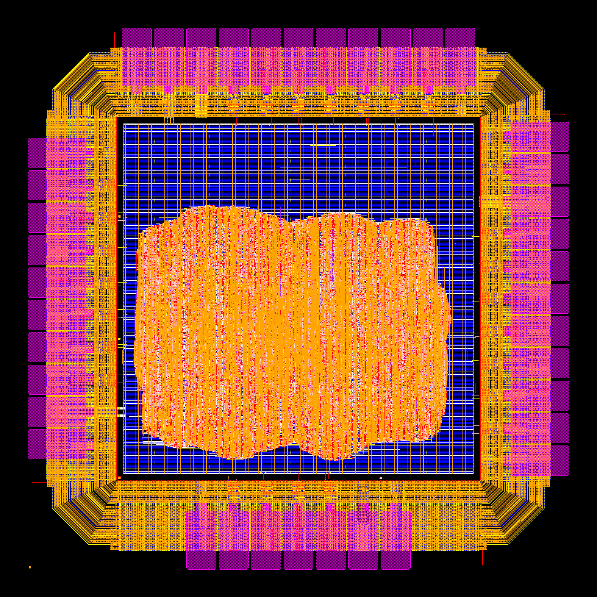
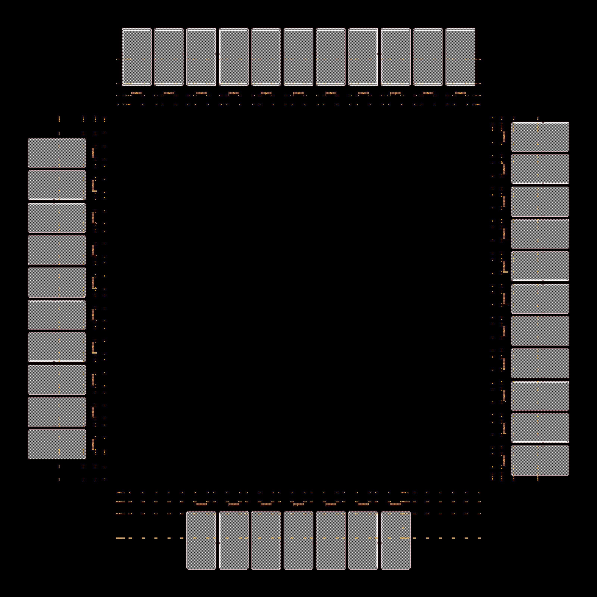

# io_port：带 IO pad 的 N28 RTL2GDS 项目

`io_port` 是一个串行接口控制的 GPIO 与寄存器缓存设计，采用 TSMC 28HPC+ 工艺。工程覆盖 RTL 仿真、综合、DFT、布局布线、GDS 导出和物理验证，包含完整的 IO 环、bond pad 和标准单元 core。

## 最终版图


[查看原图](images/rtl2gds/io_port_layout_user_2026-11-15.png)

| 项目 | 参数 |
| --- | --- |
| 工艺 | TSMC 28HPC+，7-track 标准单元 |
| 金属栈 | 9M 4X2Y2R |
| Die | 838×838 µm |
| 缓存 | 1024×32 位（4 KiB），标准单元实现 |
| 信号 IO / 电源与地 IO | 25 / 14 |
| Bond pad | 39 |
| Corner / IO filler | 4 / 128 |
| IO 节距 | 50 µm |
| 扫描链 | 1 条，32,934 bits |

GPIO 电路采用 7lm 视图，搭配 9M 4X2Y2R bond pad。IO 环距 die 边缘 30 µm，core margin 至少 150 µm。

<details>
<summary>查看布线与焊盘分布</summary>

### M1–M9 布线



### 焊盘与开口



</details>

## 设计功能

50 MHz 串行接口控制 8 位 GPIO 输入、8 位 GPIO 输出和 4 KiB 缓存。每帧 56 位，按 MSB first 传输：

```text
{opcode[7:0], address[15:0], data[31:0]}
```

上一条命令的 32 位响应在下一帧前 32 位返回。未满 56 位便释放 CS 的帧会被丢弃。低有效异步复位清除控制器和 GPIO，缓存需要先写后读。

| Opcode | 功能 |
| --- | --- |
| `01` | 写一个 32 位缓存字 |
| `02` | 读一个缓存字，地址 0–1023 |
| `03` | 写 GPIO 输出 |
| `04` | 读 GPIO 输入 |
| `05` | 读有效写入数据的累计 XOR 校验值 |

RTL 仿真覆盖全部缓存地址、GPIO、校验值、非法地址、半帧和复位。

## 运行方法

以下命令用于完整工程，需要配置相应 EDA 工具和工艺库。仓库中的 [rtl2gds_small](../rtl2gds_small/README.md) 为功能削减版。

在 `pr_env/scripts/utilities/pr_user_setting.template.tcl` 中开启 IO pad：

```tcl
set IO_PAD 1
```

```bash
# 功能仿真
bash DESIGN/io_port/run_sim.sh

# 完整 RTL2GDS 流程
bash DESIGN/io_port/run_rtl2gds.sh
```

也可以按阶段运行：

```bash
make -C be_env run_fc_syn run_dft_insert b=io_port
make -C pr_env pnr_all b=io_port
make -C pr_env physical_signoff_all b=io_port
```

已有 GDS 时，使用 `make -C pr_env physical_checks_all b=io_port` 重新执行物理检查。开启 `IO_PAD` 时 DRC 使用 fullchip 范围，关闭时使用 block 范围。

最终文件为 `pr_env/io_port/results/signoff/io_port.pnr.dummy.gds`，顶层为 `merge_io_port`。

## 验证结果

| 检查 | 结果 |
| --- | --- |
| FC 布线、PG 连通性与内部 LVS | 零违例 |
| Formality | 等价验证通过 |
| Calibre 填充前 / 填充后 LVS | 均为 `CORRECT` |
| ERC | 剩余 246 条层级结果，属于指定 IO 单元的可 waive 项 |
| 填充后 fullchip DRC | 剩余 RR、ESD 和条件提醒按项目 waiver 结论记录 |
| Antenna / MIM antenna | 均为 0（此前 block 范围检查） |
| GDS 层级 | 无未解析引用 |

ERC 剩余规则为 `mnpg`、`floating.nxwell_float` 和 `npvss49`，位于电源/地 IO 内；外围衬底接地问题已修复。当前版图尚未加入机械 seal-ring。

[详细检查记录](evidence/2026-11-14-io-port-summary.json)

## 更多流程案例

[早期 SPI 项目](RTL2GDS_SPI_2026-09.md) 包含十二场景时序、205 patterns 扫描回放、四角 IR 和联合 ECO 记录。另见[流程截图](RTL2GDS_ARCHIVE_2026-09-04.md)和[早期 DOCX](RTL2GDS.docx)。
