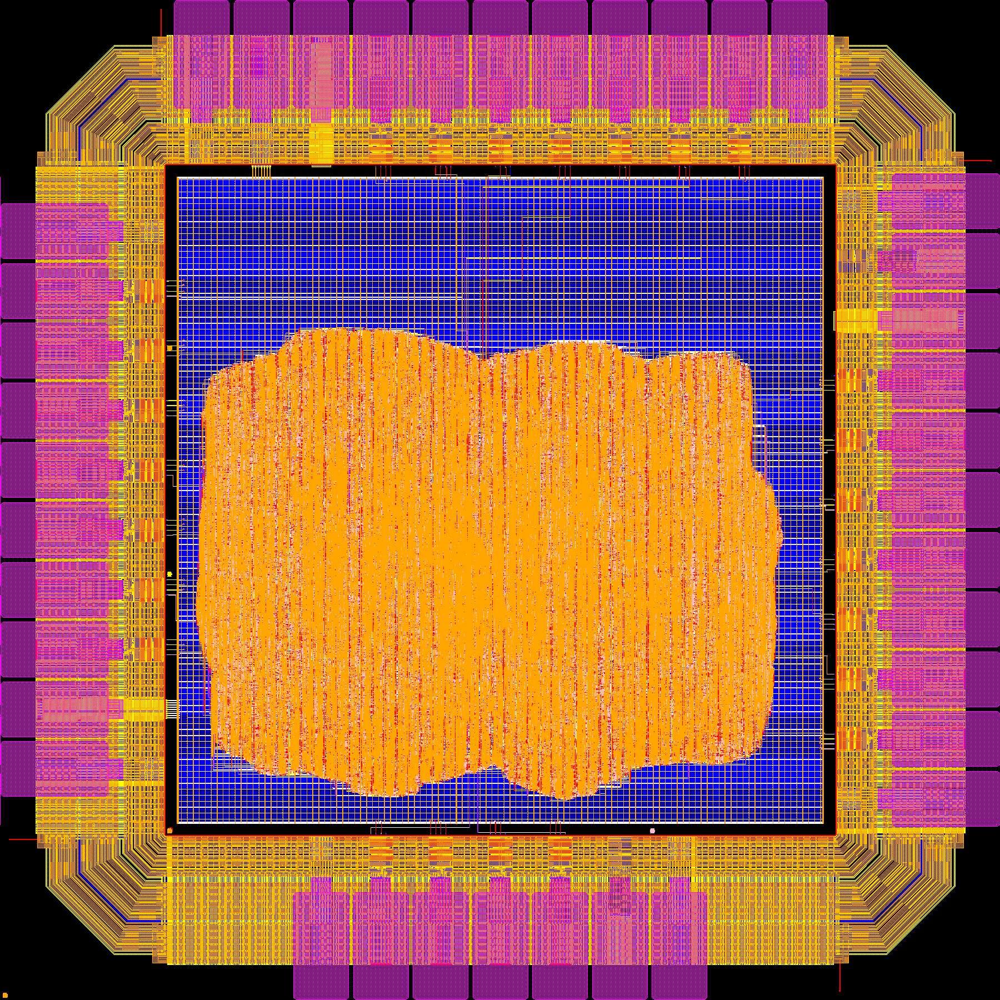
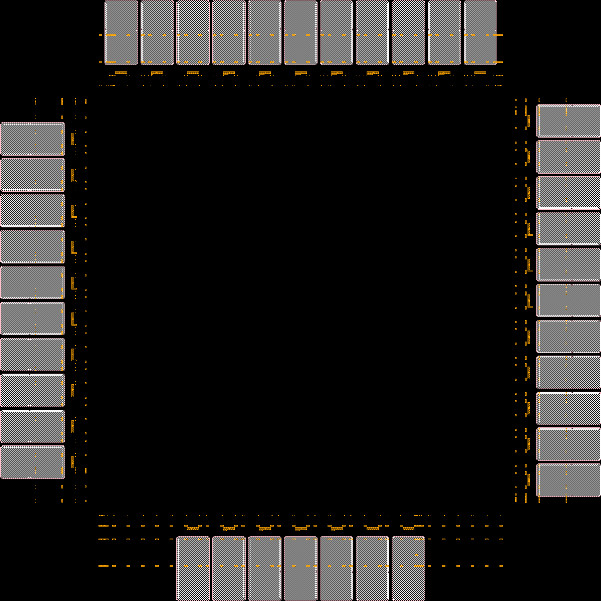
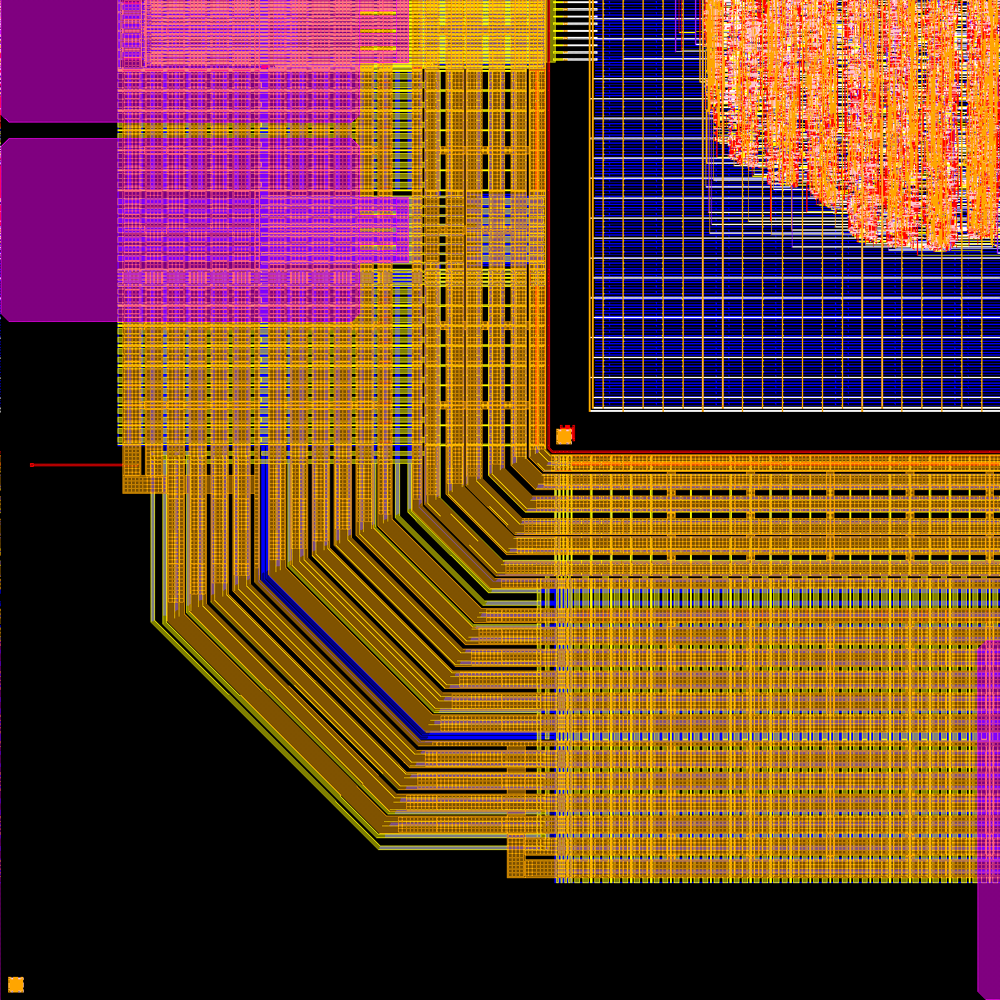

# RTL2GDS：io_port 带 IO pad 的 N28 实现

当前项目为 **`io_port` + TSMC 28HPC+（N28）**，包含同步串行接口、GPIO、4 KiB 寄存器缓存、真实 IO 环和 bond pad。本文记录 2026-11-14 的最终导出版图及验证结果，替换原 SMIC18 案例展示。

## 最终版图


上图由 **Calibre DESIGNrev** 从签核输入 `results/signoff/io_port.pnr.dummy.gds` 原生导出，显示全部图层，包括器件、互连、IO 环、bond pad 和 dummy fill。顶层为 `merge_io_port`，其 SHA-256 与最终 postfill fullchip DRC 输入一致。

| 项目 | 最终实现 |
| --- | --- |
| 工艺 / 金属栈 | TSMC 28HPC+，7-track 标准单元，9M 4X2Y2R |
| Die | 838×838 µm |
| 缓存 | 1024×32 位（4 KiB），标准单元实现 |
| 信号 IO | 25 |
| 电源 / 地 IO | 14 |
| Bond pad | 39，每个信号或电源/地 IO 配一个 |
| Corner / IO filler | 4 / 128 |
| IO 节距 | 50 µm |
| 扫描链 | 1 条，32,934 bits |
| Mapped / postfill GDS cells | 400 / 445 |
| 未解析 GDS 引用 | 两版均为 0 |

### 辅助布线视图（仅 M1–M9）



该辅助图仅显示 M1–M9 drawing layers，隐藏 dummy fill 等其他图层，便于查看布线结构；首页和本页主图使用上方的完整层视图。

### IO 与 bond pad



该视图选择 AP、CB、CB2W 和 M7 标签层，显示 39 个 bond pad 的分布。GPIO 电路采用 7lm 视图，与 9M 4X2Y2R bond pad 配套；IO 环距 die 边缘 30 µm，自动 core margin 至少 150 µm。

### 角部布线



最终实现还接入四个外围衬底接地点，Calibre LVS/ERC 中原来的 `floating.psub` 结果已消除。

## 设计功能

`io_port` 由 50 MHz `spi_clk` 驱动，同步串行接口控制 8 位 GPIO 输入、8 位 GPIO 输出和 4 KiB 寄存器缓存。缓存由标准单元实现并参与扫描插链。

每帧 56 位，MSB first：`{opcode[7:0], address[15:0], data[31:0]}`。上一条命令的 32 位响应出现在下一帧前 32 位；不足 56 位就释放 CS 的帧会被丢弃。

| Opcode | 功能 |
| --- | --- |
| `01` | 写一个 32 位缓存字 |
| `02` | 读一个缓存字，地址 0–1023 |
| `03` | 写 8 位 GPIO 输出 |
| `04` | 读取 8 位 GPIO 输入 |
| `05` | 读取有效写入数据的累计 XOR 校验值 |

低有效异步复位清除控制器和 GPIO；缓存内容先写后读。RTL 仿真覆盖全部缓存地址、GPIO、校验值、非法地址、半帧及复位。

## 实现流程与运行入口

以下命令在完整工程根目录执行，需要已配置的 EDA 工具与授权工艺库。GitHub 中的 [rtl2gds_small](../rtl2gds_small/README.md) 仍为功能削减版；本文记录完整本地工程的运行方式，不表示削减版已包含此设计与全部签核能力。

```text
RTL / SDC
  → FC 综合 → DFT 插链
  → Floorplan / 真实 IO 环 / 电源网络
  → Placement → CTS → Route → Chip finish
  → Formality / FC 物理检查
  → Mapped GDS → Calibre dummy fill → Postfill GDS
  → Calibre DRC / LVS / ERC / Antenna → DESIGNrev 版图检查
```

带 pad 实现前，在 `pr_env/scripts/utilities/pr_user_setting.template.tcl` 中配置：

```tcl
set IO_PAD 1
```

公共入口根据 `IO_PAD` 派生 N28 DRC 范围：开启时为 `fullchip`，关闭时为 `block`。设计阶段参数保存在 Tcl 中。

```bash
# 功能仿真与完整工程入口
bash DESIGN/io_port/run_sim.sh
bash DESIGN/io_port/run_rtl2gds.sh

# 分阶段重新实现
make -C be_env run_fc_syn run_dft_insert b=io_port
make -C pr_env pnr_all b=io_port
make -C pr_env physical_signoff_all b=io_port
```

已有最终 mapped GDS 时，可通过 `physical_checks_all` 重跑物理检查；已有最终 GDS 和报告时，可重新生成原生版图图像与汇总：

```bash
make -C pr_env physical_checks_all b=io_port
make -C pr_env run_calibredrv_review report_signoff_review b=io_port
```

检查入口保留原始工具结果及退出状态。剩余 DRC/ERC 的项目处置按下节记录。

## 当前验证状态

以下数值来自当前工程报告。**剩余 DRC/ERC 项由维护者确认可 waive**；此处保留工具原始计数以便追溯，可 waive 的处置说明与原生零违例结果分别记录。

| 检查 | 结果 |
| --- | --- |
| FC 布线、PG DRC / 连通性、内部 LVS | 零违例 |
| Formality | `Verification SUCCEEDED` |
| Calibre prefill / postfill LVS | 拓扑比较均为 `CORRECT` |
| ERC | 两版均为 246 条层级 / 426 条展开结果；剩余项按维护者确认可 waive |
| Postfill fullchip DRC | 原始总数 16,136,780；85 类非零规则；剩余项按维护者确认可 waive |
| 其中 RR 推荐 / 指导规则 | 79 类，16,136,560 条 |
| 其中非 RR | 220 条，分类见下表 |
| Antenna / MIM antenna | 均为 0；保留此前 block 范围检查结果 |
| Calibre DESIGNrev | Mapped / postfill 为 400 / 445 cells，未解析引用均为 0 |

最新 fullchip 检查针对最终 postfill GDS；prefill DRC 与 antenna 保留此前 block 范围结果。截图和结果所对应的 GDS 哈希见下节。

| Postfill 非 RR 项 | 原始数量 |
| --- | ---: |
| `ESD.18g` | 120 |
| `ESD.19g` | 96 |
| `DIODMY_L:WARNING` | 1 |
| `WITH_SEALRING_OPTION:WARNING` | 1 |
| `MATCH.WARN.1` | 1 |
| `MOM.R.2` | 1 |

ERC 剩余项为 `mnpg=242`、`floating.nxwell_float=2`、`npvss49=2`，定位在电源/地 IO 内。上述 DRC/ERC 项采用维护者提供的可 waive 结论，原始计数未改写为零。机械 seal-ring 尚未加入本版版图。

## 图像与结果来源

发布的 PNG 为 Calibre DESIGNrev 原生导出图，直接复制自完整工程的 `pr_env/io_port/reports/signoff/calibredrv/postfill/`。它们展示实际 GDS 几何；布线层图、完整层图和焊盘图通过文件名区分。

最终 postfill GDS 的 SHA-256：

```text
471b120331b530d0c4fd81b2a90fc5b415ae2d176182e33b8608fb01b327d447
```

[机器可读结果与图片 SHA-256](evidence/2026-11-14-io-port-summary.json) 记录了图像来源、GDS 结构、原始检查计数及维护者处置说明。GDS、工艺库和完整工具报告保存在本地工程，仓库发布项目文档与展示图。

## 历史流程记录

[2026-09 SPI / N28 流程](RTL2GDS_SPI_2026-09.md) 保留早期十二场景时序、205 patterns 回放、四角 IR 和联合 ECO 记录；这些数据属于当时的 `spi_slave`。另见[各阶段截图](RTL2GDS_ARCHIVE_2026-09-04.md)和[初版 DOCX 历史存档](RTL2GDS.docx)。
