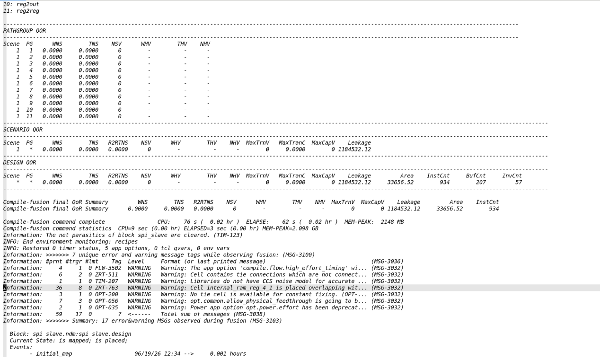
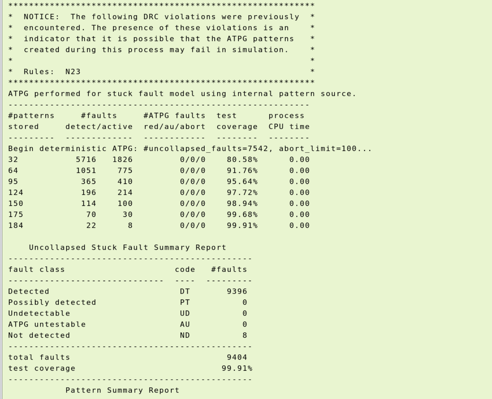
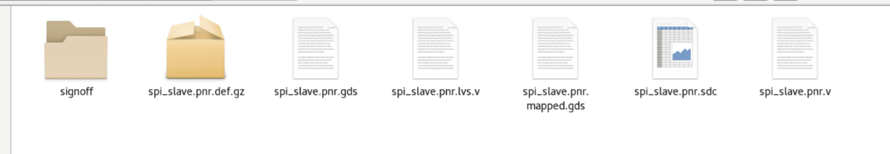
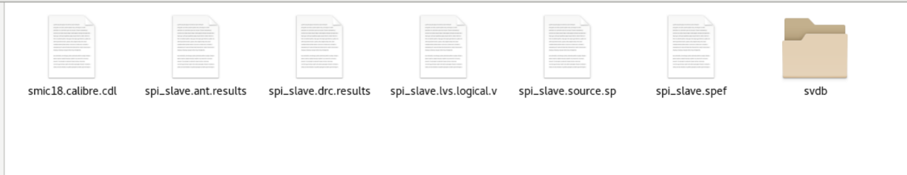
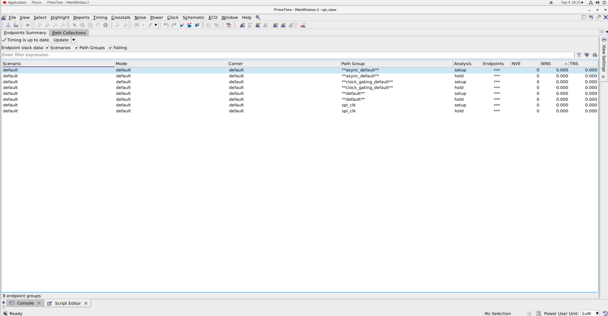

# RTL2GDS 各阶段截图

当前 `io_port` 版图和早期项目的工具界面。项目参数与运行方法见 [RTL2GDS](RTL2GDS.md)。除版图外，其余截图为早期流程记录。

## 综合 QoR

## DFT / ATPG

## 前端交付物

## 布局布线交付物

## Formality 等价验证

## 签核产物

## 最新 GDS 视图：io_port / TSMC N28（2026-11-14）

[查看原图](images/rtl2gds/io_port_layout_user_2026-11-15.png)

838×838 µm，25 个信号 IO、14 个电源/地 IO、39 个 bond pad。

## IO pad / bond pad 视图

单独显示焊盘金属和开口，便于查看四边 pad 的分布。

## PrimeTime 分析界面

## RedHawk IR 视图

## Calibre RVE

更多内容：[SPI 项目记录](RTL2GDS_SPI_2026-09.md) · [早期 DOCX](RTL2GDS.docx)。
