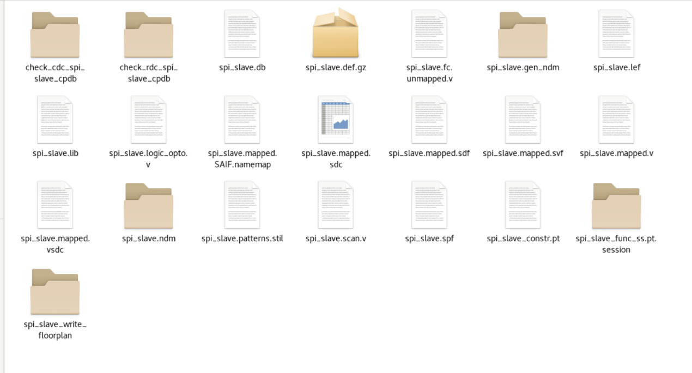
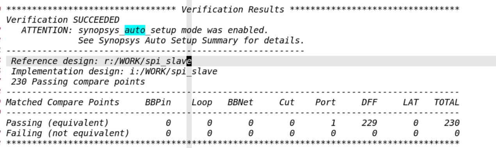
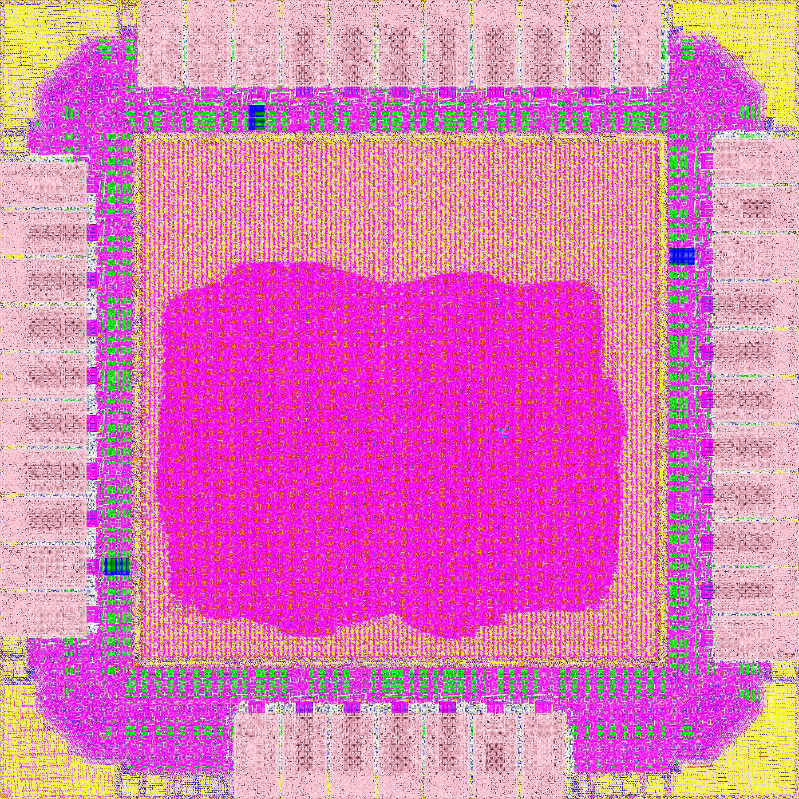
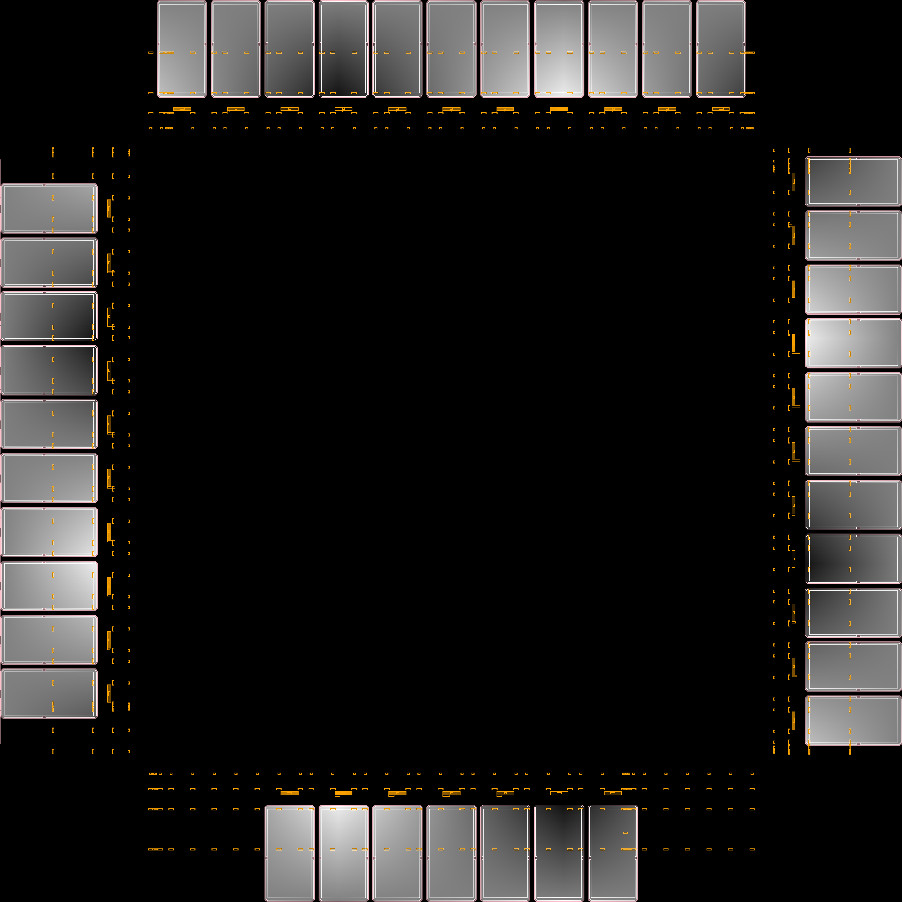
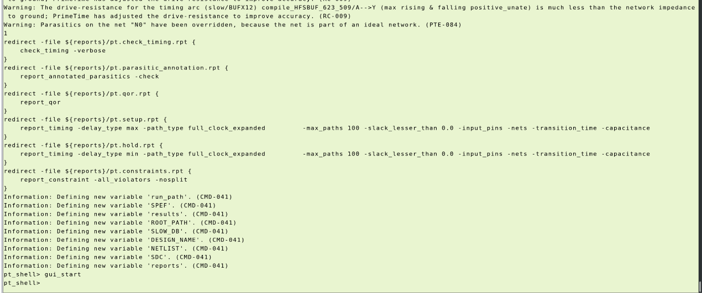
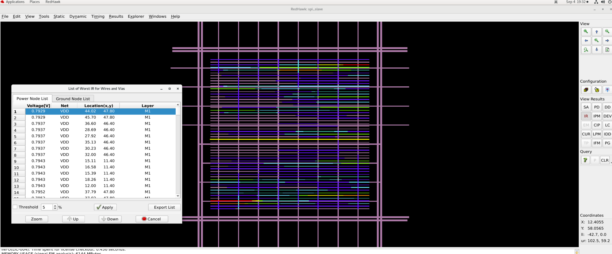
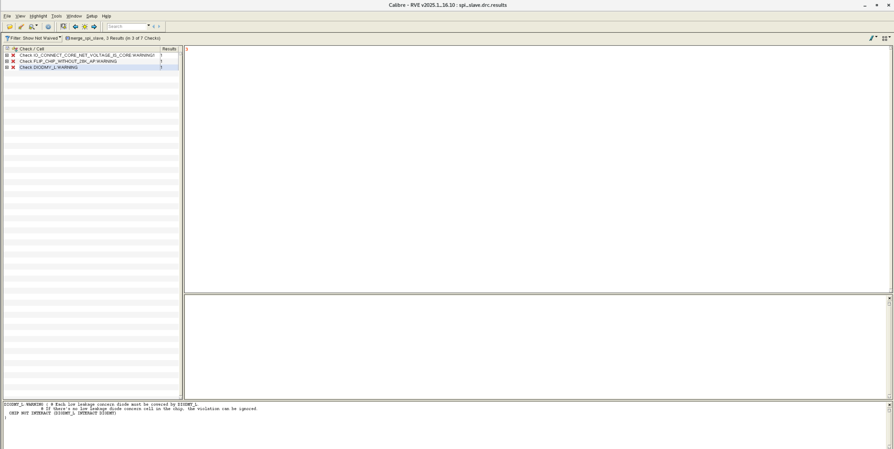
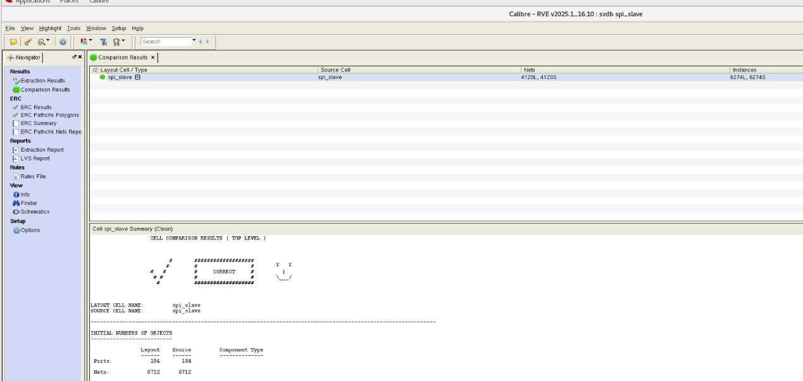

# RTL2GDS 各阶段截图

这组截图展示综合、DFT、布局布线、形式验证、时序分析和物理验证的工具界面。本页已用最新 `io_port` 带 IO pad 的 N28 版图替换旧 SMIC18 展示；其余工具界面保留为历史截图，不表示新项目通过相同检查。最新状态见 [RTL2GDS 全流程](RTL2GDS.md)。

## 综合 QoR

## DFT / ATPG

## 前端交付物

## 布局布线交付物

## Formality 等价验证

## 签核产物

## 最新 GDS 视图：io_port / TSMC N28（2026-11-14）

838×838 µm，25 个信号 IO、14 个电源/地 IO、39 个 bond pad。图像由 Calibre DESIGNrev 从签核输入 `results/signoff/io_port.pnr.dummy.gds` 原生导出，显示全部图层及 dummy fill。

## IO pad / bond pad 视图

该图选择 AP、CB、CB2W 和 M7 标签层，展示焊盘位置；完整层图及当前验证状态见 [项目记录](RTL2GDS.md)。

## PrimeTime 分析界面

## RedHawk IR 视图

## Calibre RVE

本页其余阶段截图整理于 2026-09-04。历史 SPI 十二场景、ATPG 和 IR 数值见 [SPI 记录](RTL2GDS_SPI_2026-09.md)；原始图文保留在 [DOCX 历史存档](RTL2GDS.docx)，不作为当前项目状态依据。
